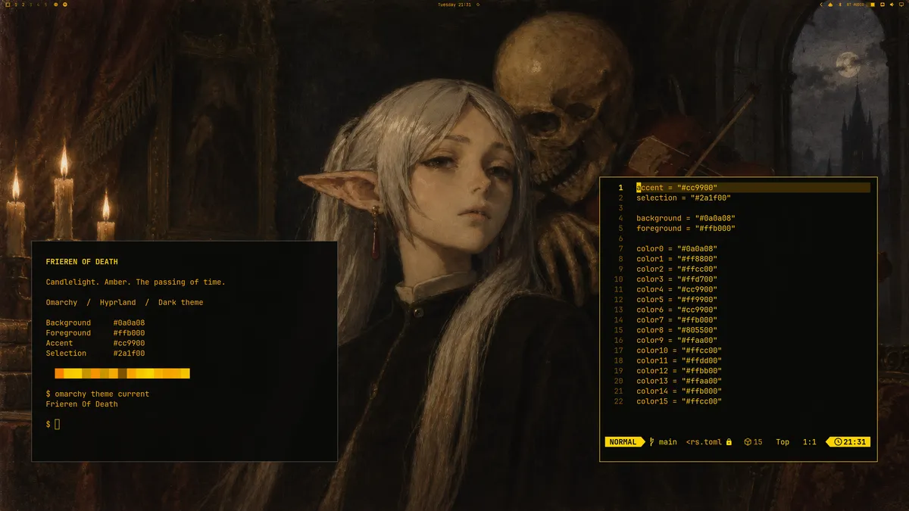

# Frieren of Death

A dark amber theme for [Omarchy](https://omarchy.org/), pairing the RetroPC palette with a candlelit Frieren and Death wallpaper.



[Full-resolution wallpaper](backgrounds/frieren-of-death.png)

## Install

```bash
omarchy theme install https://github.com/Matt1656/omarchy-frieren-of-death-theme
```

Once installed, select **Frieren Of Death** in the theme switcher, or run:

```bash
omarchy theme set "Frieren of Death"
```

## Palette

| Role | Color |
| --- | --- |
| Background | `#0a0a08` |
| Foreground | `#ffb000` |
| Accent | `#cc9900` |
| Selection | `#2a1f00` |
| Bright highlight | `#ffcc00` |

## Included

The active theme configuration was captured on September 22, 2026, from Omarchy 4.0.4. It includes the color palette, shell styling, application theme files, legacy application styles, and the full-resolution wallpaper.

Current Omarchy releases regenerate terminal and Lua configuration from `colors.toml` when installing a GitHub theme. Those saved files are also included here to preserve the original configuration and support older releases. Desktop layout, personal keybindings, and unrelated system settings are not part of this theme.

The bundled RetroPC font is optional. To use it with legacy applications that reference it:

```bash
mkdir -p ~/.local/share/fonts/retro
cp ~/.config/omarchy/themes/frieren-of-death/fonts/Bm437_IBM_XGA-AI_12x23.otb ~/.local/share/fonts/retro/
fc-cache
```

## Credits and license

Based on [RetroPC by Ron Dilley](https://github.com/rondilley/omarchy-retropc-theme), which credits [Ash by Bjarne Øverli](https://github.com/bjarneo/omarchy-ash-theme) as inspiration. The original GPL-3.0 license is retained in [LICENSE](LICENSE) for the theme configuration. The bundled font is retained from RetroPC.

Packaged and renamed by Matt1656 on September 22, 2026, with the selected Frieren wallpaper replacing the original background. The wallpaper is supplied separately from the theme code; no ownership of the depicted characters or third-party artwork is claimed.
